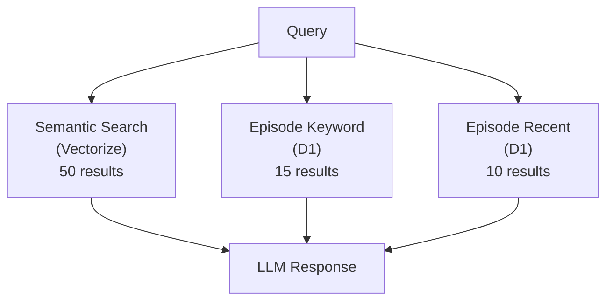

# @aid-on/embersm

<div align="center">

[](https://www.npmjs.com/package/@aid-on/embersm)
[](https://www.typescriptlang.org/)
[](https://opensource.org/licenses/MIT)

**Cloudflare Workers native 5-layer memory architecture**

Provide long-term memory for LLM agents

**English** | [日本語](README.ja.md)

</div>

## Benchmark Results

Evaluation on the LOCOMO benchmark (100 questions):

| Configuration | Score | vs Mem0 |
|---------------|-------|---------|
| **Best (Semantic + Episode)** | **66-75%** | **+25-34%** |
| 5-Layer (temporal/graph added) | 47-55% | +6-14% |

> Mem0 baseline: 41%

### Best Configuration

The simplest configuration achieved the highest scores:

```
Semantic Search (50 results) + Episode Keyword (15) + Recent (10)
```

The 5-layer architecture (with Temporal/Graph) introduces noise and is not recommended at this time.

## Architecture

### Best Configuration (Recommended)



### 5-Layer Architecture (Experimental)

> Temporal/Graph layers introduce noise at this stage; the best configuration above is recommended

```
Query Router → Semantic / Temporal / Graph / Episode → Fusion → LLM
```

### Layer Roles

| Layer | Storage | Purpose | Latency |
|-------|---------|---------|---------|
| **Flash** | KV | Recent context (last few turns) | ~1ms |
| **Episode** | D1 | Full conversation history | ~5ms |
| **Semantic** | Vectorize | Vector similarity search | ~10ms |
| **Temporal** | D1 | Time-indexed event management | ~5ms |
| **Graph** | D1 | Facts & relationships in Prolog format | ~5ms |

## Installation

```bash
npm install @aid-on/embersm
```

## Usage

### Basic Usage

```typescript
import { createEmbersM } from "@aid-on/embersm";

// Initialize from Cloudflare Workers env
const memory = createEmbersM(env);

// Record a conversation turn
await memory.extract(
  userId,
  threadId,
  userMessage,
  assistantResponse
);

// Query memory
const context = await memory.query(userId, question);
```

### D1 Migrations

```typescript
import {
  EPISODE_MIGRATION,
  SEMANTIC_MIGRATION,
  TEMPORAL_MIGRATION,
  GRAPH_MIGRATION,
} from "@aid-on/embersm";

// Create tables in D1
await env.DB.exec(EPISODE_MIGRATION);
await env.DB.exec(SEMANTIC_MIGRATION);
await env.DB.exec(TEMPORAL_MIGRATION);
await env.DB.exec(GRAPH_MIGRATION);
```

### Environment Configuration

`wrangler.toml`:

```toml
[[kv_namespaces]]
binding = "KV"
id = "your-kv-namespace-id"

[[d1_databases]]
binding = "DB"
database_name = "your-db-name"
database_id = "your-db-id"

[[vectorize]]
binding = "VECTORIZE"
index_name = "your-index-name"

[ai]
binding = "AI"
```

## API

### `createEmbersM(env: EmbersMEnv): EmbersM`

Main factory function.

```typescript
interface EmbersM {
  // Extract and store memories from a conversation turn
  extract(
    userId: string,
    threadId: string,
    userMessage: string,
    assistantResponse: string
  ): Promise<MemoryUpdates>;

  // Query memory and generate context
  query(userId: string, question: string): Promise<MemoryContext>;

  // Run D1 migrations
  migrate(): Promise<void>;
}
```

### Memory Context

```typescript
interface MemoryContext {
  flash: string[];      // Recent conversation
  episodes: string[];   // Related past conversations
  semantic: string[];   // Semantically similar content
  temporal: string[];   // Time-related events
  graph: string[];      // Relationships & facts
  fusedContext: string;  // Fused context string
}
```

## Testing

```bash
# Unit tests
npm test

# Benchmarks (mock environment)
npm run benchmark
```

## Technical Highlights

### High-Accuracy Temporal Memory (94.4%)

- Automatically extracts datetime information from conversations
- Resolves relative dates ("yesterday", "last week") based on conversation timestamp
- Classifies event types (one-time / recurring / duration)

### Semantic Search

- Fast vector search via Cloudflare Vectorize
- 768-dimensional embeddings with BGE-base-en-v1.5 model
- Indexes both user and assistant messages

### Graph Memory

- Stores facts in Prolog format: `predicate(subject, object)`
- Example: `painted(Melanie, lake sunrise)`, `attended(Caroline, LGBTQ support group)`
- Supports inference queries

## License

MIT
