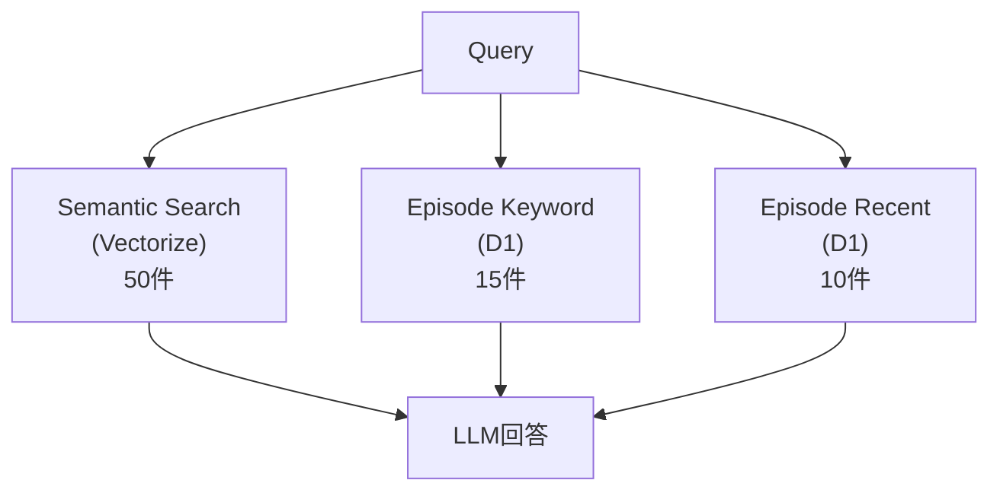

# @aid-on/embersm

Cloudflare Workers 向けのメモリアーキテクチャ。LLM エージェントに長期記憶を提供する。

## ベンチマーク結果

LOCOMO ベンチマーク（100問）での評価結果：

| 構成 | スコア | Mem0 比較 |
|------|--------|-----------|
| **Best (Semantic + Episode)** | **66-75%** | **+25-34%** |
| 5-Layer (temporal/graph追加) | 47-55% | +6-14% |

> Mem0 baseline: 41%

### ベスト構成

検証の結果、シンプルな構成が最も高いスコアを達成：

```
Semantic Search (50件) + Episode Keyword (15件) + Recent (10件)
```

5層アーキテクチャ（Temporal/Graph追加）は現時点ではノイズになるため使用しない。

## アーキテクチャ

### ベスト構成（推奨）



### 5層アーキテクチャ（実験的）

> 現時点では Temporal/Graph がノイズになるため、ベスト構成を推奨

```
Query Router → Semantic / Temporal / Graph / Episode → Fusion → LLM
```

### 各レイヤーの役割

| レイヤー | ストレージ | 目的 | 応答時間 |
|---------|-----------|------|---------|
| **Flash** | KV | 直近のコンテキスト（数ターン） | ~1ms |
| **Episode** | D1 | 会話履歴の完全保存 | ~5ms |
| **Semantic** | Vectorize | ベクトル類似度検索 | ~10ms |
| **Temporal** | D1 | 時間軸でのイベント管理 | ~5ms |
| **Graph** | D1 | 事実・関係性の Prolog 形式保存 | ~5ms |

## インストール

```bash
npm install @aid-on/embersm
```

## 使用方法

### 基本的な使い方

```typescript
import { createEmbersM } from "@aid-on/embersm";

// Cloudflare Workers の env から初期化
const memory = createEmbersM(env);

// 会話ターンを記録
await memory.extract(
  userId,
  threadId,
  userMessage,
  assistantResponse,
  turnIndex
);

// メモリを検索
const context = await memory.query(userId, question);
```

### D1 マイグレーション

```typescript
import {
  EPISODE_MIGRATION,
  SEMANTIC_MIGRATION,
  TEMPORAL_MIGRATION,
  GRAPH_MIGRATION,
} from "@aid-on/embersm";

// D1 でテーブル作成
await env.DB.exec(EPISODE_MIGRATION);
await env.DB.exec(SEMANTIC_MIGRATION);
await env.DB.exec(TEMPORAL_MIGRATION);
await env.DB.exec(GRAPH_MIGRATION);
```

### 環境設定

`wrangler.toml`:

```toml
[[kv_namespaces]]
binding = "KV"
id = "your-kv-namespace-id"

[[d1_databases]]
binding = "DB"
database_name = "your-db-name"
database_id = "your-db-id"

[[vectorize]]
binding = "VECTORIZE"
index_name = "your-index-name"

[ai]
binding = "AI"
```

## API

### `createEmbersM(env: EmbersMEnv): EmbersM`

メインのファクトリ関数。

```typescript
interface EmbersM {
  // 会話ターンからメモリを抽出・保存
  extract(
    userId: string,
    threadId: string,
    userMessage: string,
    assistantResponse: string,
    turnIndex: number
  ): Promise<MemoryUpdates>;

  // メモリを検索してコンテキストを生成
  query(userId: string, question: string): Promise<MemoryContext>;
}
```

### メモリコンテキスト

```typescript
interface MemoryContext {
  flash: string[];      // 直近の会話
  episodes: string[];   // 関連する過去の会話
  semantic: string[];   // 意味的に類似した内容
  temporal: string[];   // 時間関連のイベント
  graph: string[];      // 関係性・事実
  fusedContext: string; // 統合されたコンテキスト
}
```

## テスト

```bash
# ユニットテスト
npm test

# ベンチマーク（モック環境）
npm run benchmark

# 本番ベンチマーク（要 Cloudflare 認証情報）
CLOUDFLARE_API_KEY="..." \
CLOUDFLARE_EMAIL="..." \
CLOUDFLARE_ACCOUNT_ID="..." \
npx tsx scripts/benchmark-prod.ts
```

## 技術的な特徴

### Temporal Memory の高精度（94.4%）

- 会話から日時情報を自動抽出
- 相対日時（「昨日」「先週」）を会話日時を基準に解決
- イベントタイプ（単発/繰り返し/期間）を分類

### Semantic Search

- Cloudflare Vectorize で高速ベクトル検索
- BGE-base-en-v1.5 モデルで 768 次元埋め込み
- ユーザー + アシスタント両方のメッセージをインデックス

### Graph Memory

- Prolog 形式で事実を保存: `predicate(subject, object)`
- 例: `painted(Melanie, lake sunrise)`, `attended(Caroline, LGBTQ support group)`
- 推論クエリに対応

## ライセンス

MIT
